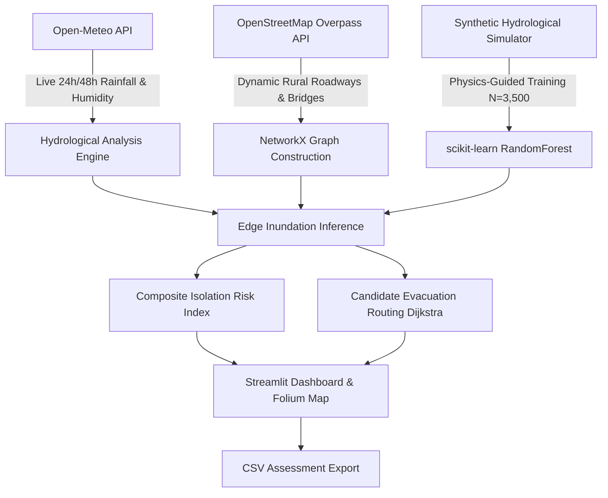

# 🛡️ VillageShield AI

> **Physics-Guided Rural Flood Isolation Prediction & Candidate Evacuation Corridor Optimizer**  
> *Developed for rapid disaster response, rural flood resilience, and emergency planning.*

---

## 🌟 Executive Summary

Rural villages in river deltas and low-lying agricultural basins—such as the Krishna River basin near **Guntur and Chebrolu, Andhra Pradesh**—frequently face severe seasonal flooding and sudden road inundation. When vital culverts and rural feeder roads submerge, entire habitations become isolated before relief teams can intervene.

**VillageShield AI** is an open-source, reproducible decision-support dashboard designed to predict rural road submergence and community isolation risks before floodwaters peak. It dynamically merges:
1. **Live Hourly Atmospheric Forecasts** directly queried from the [Open-Meteo Global Forecast API](https://open-meteo.com/).
2. **Actual Dynamic Road Infrastructure Graphs** queried from OpenStreetMap via the [Overpass API](https://wiki.openstreetmap.org/wiki/Overpass_API).
3. **Physics-Guided Machine Learning (scikit-learn RandomForest)** predicting road submergence probabilities across 24-hour and 48-hour projection windows.
4. **Topological Graph Connectivity Analytics (NetworkX)** measuring network fragmentation, isolated node percentages, and composite isolation indices.
5. **Candidate Evacuation Routing Engine** calculating both baseline shortest paths and flood-resilience-weighted candidate corridors to safe havens.
6. **Interactive Folium Geovisualization** and downloadable official audit reports in CSV format.

---

## 🔬 Core System Architecture



---

## ⚙️ Key Technical Features

### 1. Real-Time Atmospheric Telemetry (Open-Meteo API)
- Real-time ingestion of hourly precipitation, rain, showers, relative humidity, surface pressure, and wind speed for up to 3 forecast days.
- Automatic computation of **24-hour cumulative rainfall (mm)**, **48-hour cumulative rainfall (mm)**, and **peak 1-hour rainfall intensity (mm/h)**.
- Extreme storm simulation slider (1.0x to 2.5x) for stress-testing infrastructure under cloudburst or cyclonic conditions.

### 2. Live Road Infrastructure Ingestion (OSM Overpass API)
- Dynamically queries OSM ways within a user-configurable radius (1.5 km to 6.0 km) around the study village.
- Extracts road classification hierarchies (`primary`, `secondary`, `tertiary`, `residential`, `unclassified`, `track`), pavement surfaces (`asphalt`, `paved`, `gravel`, `dirt`), and bridge/culvert flags.
- Resilient fallback mechanism: If public Overpass servers experience rate-limiting or latency, an offline regional baseline network can be activated seamlessly.

### 3. Physics-Guided Synthetic Machine Learning Model
- **Algorithm:** `RandomForestClassifier` with balanced class weights, depth constraints, and stratified splitting.
- **Features Analyzed:**
  - `rain_24h_mm`: Cumulative 24-hour precipitation volume
  - `peak_intensity_mmh`: Peak 1-hour rainfall burst intensity
  - `elevation_relative_m`: Micro-terrain relative elevation
  - `road_class_rank`: Structural engineering grade of road
  - `is_unpaved`: Dirt/mud/gravel degradation factor
  - `is_bridge_or_culvert`: Backwater overflow risk
  - `antecedent_moisture_idx`: Soil saturation proxy from ambient humidity
- **Model Diagnostics:** Displays live test accuracy, ROC-AUC score, and relative feature importances in the dashboard.

### 4. Topological Isolation & Network Severance
- Analyzes graph connectivity and determines the percentage of village habitations cut off under simulated 24h inundation thresholds ($p > 0.65$).
- Categorizes overall community vulnerability into four tiers:
  - 🟢 **Low Risk (<25%):** All primary and secondary access corridors remain passable.
  - 🟡 **Moderate Watch (25-50%):** Peripheral unpaved tracks submerged; main arterial open.
  - 🟠 **High Isolation Warning (50-75%):** Partial cutoff; single exit artery remaining.
  - 🔴 **Critical Isolation Emergency (>75%):** Complete encirclement or loss of all arterial connections.

### 5. Candidate Evacuation Corridor Optimizer (NetworkX)
- Calculates and contrasts two distinct candidate paths:
  1. **Shortest Physical Path:** Traditional distance minimization.
  2. **Flood-Resilient Candidate Route:** Dijkstra traversal weighted by non-linear submergence penalty:
     $$\text{Weight} = \text{Length} \times (1.0 + 12.0 \times P_{\text{submerge}}^{2.5})$$
- Visualizes route geometry, transit distance detours, and risk reduction percentages.

---

## ⚠️ Mandatory Scientific Disclosures & Limitations

1. **Synthetic Training Labels Disclosure:**
   > Village-level flood gauges and historical submersion records for rural roads in Andhra Pradesh are rarely digitized or public. The machine learning model is trained on a **reproducibly generated synthetic dataset ($N=3,500$ samples, `random_state=42`)** derived from physics-informed hydrological runoff principles. **Synthetic labels are NOT historical flood observations.** All predictions are experimental and intended for decision-support and stress-testing only.

2. **Unverified Candidate Routes Disclaimer:**
   > All evacuation and relief access corridors are algorithmically generated hypotheses based on graph analysis and predicted probabilities. **Route safety, water depths, and structural integrity of bridges are NOT field-verified.** Local disaster management teams and residents must never dispatch emergency personnel across flooded roads without ground-truthed clearance from local authorities.

3. **Data Availability & Public API Limits:**
   > Live weather queries depend on Open-Meteo's open service availability. OpenStreetMap road extraction depends on public Overpass instances; in case of public server throttling, use the built-in regional fallback toggle.

---

## 🚀 Quickstart & Installation

### Prerequisites
- Python 3.10+ (tested up to Python 3.14)
- Internet connection (for live Open-Meteo and OpenStreetMap queries)

### Step 1: Clone or Navigate to the Workspace
```powershell
cd c:\Users\nithin\OneDrive\Documents\VillageShield-AI
```

### Step 2: Install Dependencies
Install all required libraries using pip:
```powershell
python -m pip install -r requirements.txt
```

*Or install directly:*
```powershell
python -m pip install streamlit pandas numpy scikit-learn requests networkx folium streamlit-folium
```

### Step 3: Run the Streamlit Application
Launch the interactive dashboard:
```powershell
python -m streamlit run app.py
```

The web dashboard will launch automatically in your default browser at:
```
http://localhost:8501
```

---

## 📋 Default Study Location & Controls

| Parameter | Default Value | Notes |
| :--- | :--- | :--- |
| **Study Region** | Chebrolu / Guntur Basin, Andhra Pradesh | Prone to seasonal delta flooding |
| **Latitude** | `16.3067` (Guntur Basin) / `16.2023` (Chebrolu) | Fully editable in sidebar |
| **Longitude** | `80.4365` (Guntur Basin) / `80.5283` (Chebrolu) | Fully editable in sidebar |
| **Road Buffer Radius** | `3000` meters | Adjustable between 1500m and 6000m |
| **Extreme Storm Multiplier** | `1.0x` (Live Forecast) | Up to `2.5x` for cloudburst stress-testing |
| **Fallback Network** | Enabled | Ensures continuous demo resilience |

---

## 📂 Repository File Tree

```
VillageShield-AI/
├── app.py                # Complete Streamlit dashboard, ML engine, & routing logic
├── requirements.txt      # Pinned dependency definitions
├── README.md             # Complete technical documentation & setup instructions
└── .gitignore            # Clean environment and cache exclusion rules
```

---

## 📄 License & Attribution
- **Open-Meteo:** Weather data provided under [Open-Meteo Non-Commercial / Attribution terms](https://open-meteo.com/).
- **OpenStreetMap:** Infrastructure map data © OpenStreetMap contributors, available under the Open Database License (ODbL).
- Built with ❤️ for rapid rural disaster response and community resilience.
